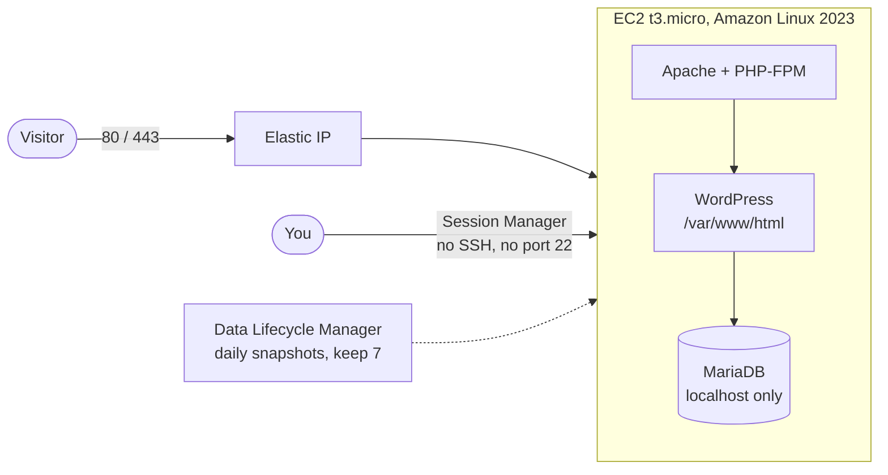

# Manual WordPress Set-up on EC2


WordPress on one Amazon Linux 2023 instance (Apache, PHP, MariaDB), set up by hand first and then automated. The value of this project is the [step-by-step manual guide](docs/manual-setup.md): what each step does and why. The same steps are in [`scripts/install-wordpress.sh`](scripts/install-wordpress.sh) and the AWS side is in [`terraform/`](terraform/).

## Architecture



## Demo

> **Screenshots and demo video:** _placeholder. Add the WordPress set-up wizard, the finished site and the snapshot policy after you deploy._

## Security choices

- No SSH key and no port 22. Access is through Session Manager (IAM-controlled and logged).
- IMDSv2 only, encrypted gp3 root volume.
- MariaDB binds to `127.0.0.1`. The database user has rights on the WordPress database only. The password is random and stored root-only in `/root/wordpress-db.txt`.
- The WordPress download is checked against the published SHA-1 checksum. Keys and salts are fresh per install.
- `DISALLOW_FILE_EDIT` is on. Apache hides its version and denies `wp-config.php`, `readme.html`, `license.txt` and `xmlrpc.php`.

## Automated version

```bash
cd terraform
terraform init
terraform apply
terraform output url
```

The instance runs the install script at first boot (about 3 to 5 minutes). Then open the URL and finish the wizard.

## Testing done

- The package list was installed in an Amazon Linux 2023 container: all packages resolve.
- The checksum and `wp-config.php` key/salt steps were run against the current WordPress release.
- ShellCheck passes. `terraform validate` and Checkov pass.
- The full script has not been run on a real EC2 instance from this repository yet. Do that before you rely on it.

## Limits

One instance is a single point of failure. See the end of the [manual guide](docs/manual-setup.md) for the next steps (RDS, ALB, Auto Scaling, S3 or EFS for uploads).

## Clean up

```bash
terraform -chdir=terraform destroy
```

Snapshots made by Data Lifecycle Manager are not deleted by `destroy`. Delete them in the EC2 console.
